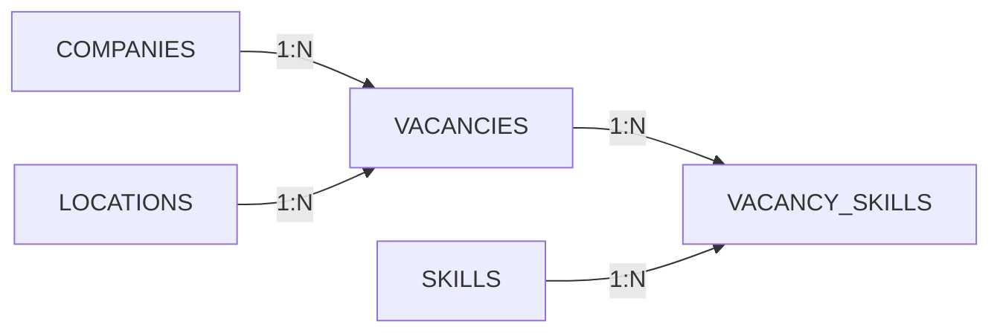

# Habr Career Scraper

Парсер вакансий с Habr Career с асинхронной загрузкой страниц и сохранением данных в SQLite через SQLAlchemy.

## Стек

- Python
- aiohttp
- asyncio
- BeautifulSoup
- SQLAlchemy
- SQLite

## Структура проекта

```text
habr-parser/
├── .gitignore
├── database/
│   ├── __init__.py
│   ├── database.py
│   └── models.py
├── main.py
├── README.md
├── requirements.txt
└── scraper/
    ├── __init__.py
    └── scraper.py
```
## Установка

Клонировать репозиторий:

    git clone <repository-url>
    cd habr-parser

Создать виртуальное окружение:

    python3 -m venv habr-venv

Активировать его:

    source habr-venv/bin/activate

Установить зависимости:

    pip install -r requirements.txt

## Парсинг

Для загрузки страниц используется aiohttp и asyncio.

Несколько страниц загружаются асинхронно, что позволяет выполнять HTTP-запросы параллельно (есть опция для разработки синхронная чтобы не поймать бан на сайте).

Для разбора HTML используется BeautifulSoup.

Из карточки вакансии извлекаются:

- название вакансии;
- компания;
- уровень специалиста;
- возможность удалённой работы;
- местоположение;
- зарплата;
- навыки;
- идентификатор вакансии на Habr Career.

Пример структуры вакансии:

    Vacancy(
        title="Senior Full-Stack Developer (Node.js + React)",
        company="Clever Craft",
        seniority="Senior",
        remote_allowed=True,
        location=None,
        salary=3400,
        skills=[
            "Node.js",
            "TypeScript",
            "React",
            "Microsoft SQL",
            "T-SQL",
            "SQL",
            "JavaScript",
            "Redux",
            "Git"
        ],
        vacancy_id=1000168896
    )

## База данных

Для хранения данных используется SQLite.

SQLAlchemy используется в качестве ORM.

Основные сущности:

### Основные сущности



### Таблица companies

Хранит информацию о компаниях.

| Поле | Описание |
|---|---|
| id | Внутренний идентификатор |
| company_name | Название компании |

### Таблица locations

Хранит местоположения вакансий.

| Поле | Описание |
|---|---|
| id | Внутренний идентификатор |
| location_name | Название местоположения |

### Таблица skills

Хранит навыки, указанные в вакансиях.

| Поле | Описание |
|---|---|
| id | Внутренний идентификатор |
| skill_name | Название навыка |

### Таблица vacancies

Хранит основную информацию о вакансиях.

| Поле | Описание |
|---|---|
| id | Внутренний идентификатор |
| title | Название вакансии |
| company_id | Идентификатор компании |
| seniority | Уровень специалиста |
| remote_allowed | Возможность удалённой работы |
| location_id | Идентификатор местоположения |
| salary | Зарплата |
| habr_id | Идентификатор вакансии на Habr Career |

habr_id является уникальным идентификатором вакансии на стороне Habr Career и используется для предотвращения повторного добавления одной и той же вакансии.

### Таблица vacancy_skills

Связывает вакансии и навыки.

| Поле | Описание |
|---|---|
| vacancy_id | Идентификатор вакансии |
| skill_id | Идентификатор навыка |

vacancy_id и skill_id образуют составной первичный ключ.

## SQLAlchemy

ORM-модели находятся в:

    database/models.py

Базовый класс моделей:

    class Base(DeclarativeBase):
        pass

Все ORM-модели наследуются от Base.

Пример модели:

    class Vacancy(Base):
        __tablename__ = "vacancies"

        id: Mapped[int] = mapped_column(primary_key=True)
        title: Mapped[str]
        company_id: Mapped[int] = mapped_column(
            ForeignKey("companies.id")
        )

Mapped[...] используется для описания ORM-полей и их Python-типов.

mapped_column() позволяет задавать параметры столбца, например первичный ключ, внешний ключ и другие ограничения.

## Создание базы данных

Настройка подключения к SQLite находится в:

    database/database.py

SQLAlchemy Engine отвечает за управление подключением к базе данных.

Для создания таблиц используется:

    Base.metadata.create_all(engine)

create_all() создаёт отсутствующие таблицы, описанные в ORM-моделях.

При этом существующие таблицы не изменяются. Для изменения уже существующей структуры базы данных необходимо использовать миграции.

## SQLite

После запуска проекта базу данных можно открыть через SQLite CLI:

    sqlite3 habr_career.db

Посмотреть список таблиц:

    .tables

Посмотреть структуру таблицы:

    .schema vacancies

Получить данные:

    SELECT * FROM vacancies;

Выйти из SQLite:

    .quit

Также базу данных можно открыть через GUI-клиент для SQLite, например DB Browser for SQLite.

## Сохранение и пополнение базы

Запуск из корня проекта:

    python main.py

Программа собирает первые две страницы и передаёт вакансии в
`Database.save_vacancies()`. Метод находит или создаёт компании,
местоположения и навыки, добавляет вакансии и связи с навыками.
В консоль выводится количество добавленных и пропущенных вакансий.

Повторный запуск добавляет новые вакансии из просмотренных страниц.
Записи с уже известным `habr_id` пропускаются без обновления.
Весь переданный список сохраняется одной транзакцией: при ошибке изменения
этого вызова откатываются. База `habr_career.db` создаётся относительно
рабочей папки запуска программы.

## Аналитика: SQLAlchemy и pandas

После сбора данных запустите из корня проекта:

    python analytics.py

Если терминал Windows выдаёт `UnicodeEncodeError` при выводе русских букв,
включите UTF-8 для этого запуска:

    python -X utf8 analytics.py

Если pandas ещё не установлен:

    python -m pip install "pandas>=2.2,<4"

Скрипт читает существующую базу, не изменяет записи и не обращается к сайту.
Каждая из пяти агрегаций реализована дважды независимо:

- `analytics_sqlalchemy.py`: соединения, группировки, подсчёты и средние
  вычисляются запросами SQLite, сформированными через SQLAlchemy.
  Результат — список словарей; pandas в этом модуле не используется.
- `analytics_pandas.py`: из БД загружаются исходные строки таблиц без SQL-агрегаций.
  Все соединения (`merge`), группировки, подсчёты и средние выполняет pandas.
  Результат — `DataFrame`.
- `analytics.py`: запускает обе реализации и печатает результаты рядом.
  Для вывода готовых результатов SQL используется `DataFrame` без дополнительных расчётов.
  Для каждого запроса выводятся блоки `SQLAlchemy` и `pandas` в одинаковом
  порядке строк. Результаты сравниваются визуально, автоматических проверок нет.

| Функция | Агрегация |
|---|---|
| `companies_by_vacancies` | Количество вакансий каждой компании |
| `seniority_distribution` | Количество вакансий каждого уровня |
| `remote_distribution` | Количество вакансий с удалёнкой и без неё |
| `skills_by_demand` | Количество вакансий с каждым навыком |
| `salary_by_seniority` | Средняя известная зарплата по уровням |

Неуказанный уровень отображается как «Не указан».
Зарплаты считаются рублёвыми по принятому в проекте условию: вилка представлена
серединой, одна граница — её значением. Сохраняется существующий запасной
источник из подсказки сайта, поэтому это статистика сохранённых оценок,
а не только точных зарплат работодателей. Пропущенная зарплата не заменяется
нулём; `NaN` в отчёте означает отсутствие значения для расчёта.

Результаты описывают накопленные вакансии, а не обязательно все активные
вакансии сайта: существующие записи при повторном сборе не обновляются.

## Обработка HTTP-запросов

При большом количестве одновременных запросов Habr Career может временно возвращать HTTP 503 Service Unavailable.

Поэтому количество одновременных запросов необходимо подбирать с учётом ограничений сервера.

## Дальнейшее развитие

Возможные направления развития проекта:

- обработка HTTP-ошибок;
- ограничение количества одновременных запросов;
- повторные попытки при временных ошибках;
